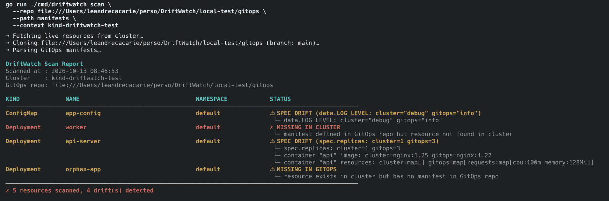
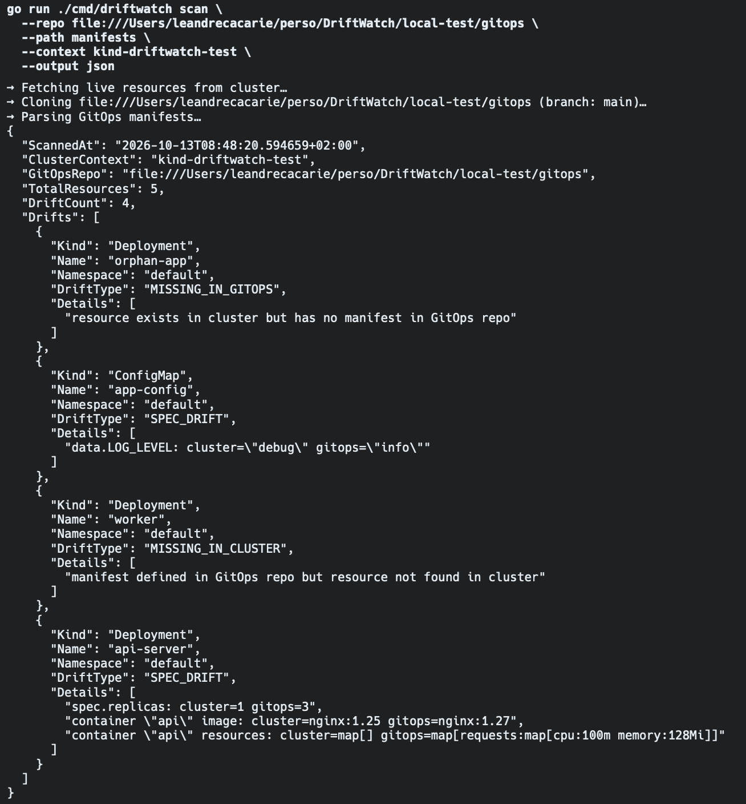
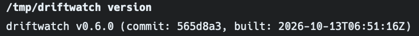

# DriftWatch

> Detect drift between your live Kubernetes cluster and your GitOps repository — works with ArgoCD and Flux.

[](https://github.com/Richonn/DriftWatch/actions/workflows/ci.yml)
[](LICENSE)
[](go.mod)

---

## What is DriftWatch?

DriftWatch is a CLI tool written in Go that compares the **live state of your Kubernetes cluster** against the **desired state declared in your GitOps repository**. It helps you catch configuration drift before it causes incidents.

It detects three types of drift:

- **Missing in cluster** — a resource is defined in GitOps but absent from the cluster
- **Missing in GitOps** — a resource is running in the cluster but not tracked in Git
- **Spec drift** — a resource exists on both sides but with differing configuration (image, replicas, resources, etc.)

---

## Installation

### Homebrew (macOS / Linux)

```bash
brew tap Richonn/driftwatch
brew install driftwatch
```

### Binary (Linux / macOS)

```bash
curl -sSfL https://github.com/Richonn/DriftWatch/releases/latest/download/driftwatch_linux_amd64.tar.gz | tar xz
sudo mv driftwatch /usr/local/bin/
```

> Windows and ARM binaries are available on the [releases page](https://github.com/Richonn/DriftWatch/releases).

### Docker

```bash
docker run --rm \
  -v ~/.kube/config:/home/nonroot/.kube/config:ro \
  ghcr.io/richonn/driftwatch:latest \
  scan --repo https://github.com/your-org/gitops
```

### Build from source

```bash
git clone https://github.com/Richonn/DriftWatch.git
cd DriftWatch
go build -o driftwatch ./cmd/driftwatch
```

Go 1.26 or later is required.

---

## Quick start

```bash
# Scan all namespaces against a public GitOps repo
driftwatch scan --repo https://github.com/your-org/your-gitops-repo

# Scan a specific namespace, on a specific cluster context
driftwatch scan \
  --repo https://github.com/your-org/your-gitops-repo \
  --namespace production \
  --context my-cluster

# Scan a monorepo — only look at the k8s/ subfolder
driftwatch scan \
  --repo https://github.com/your-org/monorepo \
  --path k8s/

# Private repo with a token
driftwatch scan \
  --repo https://github.com/your-org/private-gitops \
  --token $GITHUB_TOKEN

# Output as JSON (useful for scripting)
driftwatch scan --repo https://github.com/your-org/gitops --output json

# Auto-discover repo and path from Flux GitRepository/Kustomization resources
driftwatch scan --flux --context my-cluster

# Auto-discover repo and path from ArgoCD Application resources
driftwatch scan --argocd --context my-cluster

# Render Helm charts with custom values
driftwatch scan \
  --repo https://github.com/your-org/gitops \
  --helm-values ./overrides/prod.yaml

# Scan multiple clusters against the same GitOps repo (clones repo once)
driftwatch scan \
  --repo https://github.com/your-org/gitops \
  --cluster prod-eu \
  --cluster prod-us \
  --cluster staging

# Include Custom Resource Definition instances in the scan
driftwatch scan \
  --repo https://github.com/your-org/gitops \
  --crd

# Write a JSON report file per scan to a directory
driftwatch scan \
  --repo https://github.com/your-org/gitops \
  --report-dir ./drift-reports
```

### Example output







```
DriftWatch Scan Report
Scanned at : 2026-09-15 14:32:01
Cluster    : my-cluster
GitOps repo: https://github.com/your-org/gitops

KIND             NAME                                 NAMESPACE            STATUS
────────────────────────────────────────────────────────────────────────────────────────────────────────
Deployment       api-server                           production           ⚠ SPEC DRIFT (container "api" image: cluster=myrepo/api:v1.3.1 gitops=myrepo/api:v1.2.0)
Service          redis                                production           ✗ MISSING IN CLUSTER
Deployment       legacy-worker                        production           ⚠ MISSING IN GITOPS
────────────────────────────────────────────────────────────────────────────────────────────────────────
✗ 12 resources scanned, 3 drift(s) detected
```

---

## Flags

| Flag | Default | Description |
|------|---------|-------------|
| `--repo` | *(required)* | GitOps repository URL (HTTPS or SSH) |
| `--branch` | `main` | Branch to compare against |
| `--path` | `.` | Subdirectory within the repo (useful for monorepos) |
| `--namespace` | all | Restrict the scan to a specific namespace |
| `--kubeconfig` | `~/.kube/config` | Path to the kubeconfig file |
| `--context` | current context | Kubeconfig context to use |
| `--token` | | Auth token for private repositories |
| `--output` | `table` | Output format: `table`, `json`, or `yaml` |
| `--fail-on-drift` | `false` | Exit with code 1 if any drift is detected |
| `--helm-values` | | Extra values files passed to Helm when rendering charts (repeatable) |
| `--watch` | `false` | Re-run scan at regular intervals (Ctrl+C to stop) |
| `--interval` | `60` | Seconds between scans in watch mode |
| `--webhook` | | Webhook URL to notify on drift (Slack incoming webhook or generic HTTP endpoint) |
| `--exclude-namespace` | | Additional namespace(s) to exclude from the scan (can be repeated) |
| `--cluster` | | Kubeconfig context name to scan (can be repeated for multi-cluster; clones repo once) |
| `--crd` | `false` | Also fetch and compare Custom Resource Definition instances |
| `--report-dir` | | Directory to write one JSON report file per scan (filename: `drift-<context>-<timestamp>.json`) |

---

## Usage in CI

DriftWatch is designed to fit into your CI/CD pipelines. Use `--fail-on-drift` to block a pipeline when drift is detected.

```yaml
# .github/workflows/drift-check.yml
name: Drift Check

on:
  schedule:
    - cron: "0 * * * *"   # every hour
  workflow_dispatch:

jobs:
  scan:
    runs-on: ubuntu-latest
    steps:
      - name: Download DriftWatch
        run: |
          curl -sSfL https://github.com/Richonn/DriftWatch/releases/latest/download/driftwatch_linux_amd64.tar.gz | tar xz
          sudo mv driftwatch /usr/local/bin/

      - name: Run drift scan
        run: |
          driftwatch scan \
            --repo https://github.com/${{ github.repository_owner }}/gitops \
            --token ${{ secrets.GITHUB_TOKEN }} \
            --output json \
            --fail-on-drift
```

---

## Supported resources

DriftWatch compares the following Kubernetes resource types:

| Kind | Compared fields |
|------|----------------|
| `Deployment` | `replicas`, container images, resource requests/limits, labels |
| `StatefulSet` | `replicas`, container images, resource requests/limits, labels |
| `DaemonSet` | Container images, resource requests/limits, labels |
| `Service` | `spec.type`, `spec.clusterIP` |
| `ConfigMap` | All keys in `data` |
| `Secret` | Key names only — values are **never** read or logged |
| `Ingress` | `spec.ingressClassName` |
| `ServiceAccount` | Presence only |
| `NetworkPolicy` | Presence + spec |

System namespaces (`kube-system`, `kube-public`, `kube-node-lease`) are automatically excluded.

---

## Kubernetes Operator

DriftWatch ships a Kubernetes operator that continuously monitors your cluster by reconciling `DriftWatchScan` custom resources.

### Install

```bash
kubectl apply -f https://github.com/Richonn/DriftWatch/releases/latest/download/crd.yaml
kubectl apply -f https://github.com/Richonn/DriftWatch/releases/latest/download/rbac.yaml
kubectl apply -f https://github.com/Richonn/DriftWatch/releases/latest/download/deployment.yaml
```

### Create a scan

```yaml
apiVersion: driftwatch.io/v1alpha1
kind: DriftWatchScan
metadata:
  name: production
  namespace: driftwatch-system
spec:
  repo: https://github.com/your-org/gitops
  branch: main
  path: k8s/production
  interval: 300          # scan every 5 minutes
  namespace: production  # restrict to one namespace (optional)
  tokenSecret: gh-token  # Secret with a "token" key (optional, for private repos)
```

```bash
kubectl get driftwatchscans
# NAME         REPO                                  DRIFTS   LAST SCAN              AGE
# production   https://github.com/your-org/gitops    3        2026-10-13T14:32:01Z   2d
```

The operator reconciles every 30 s. When a `DriftWatchScan` is due (based on `spec.interval`), it runs a scan and writes the result to `status.driftCount`, `status.drifts`, and `status.lastScanAt`.

---

## Limitations

- **Helm subcharts / dependencies are not fetched automatically.** Run `helm dependency update` on the chart directory before scanning if your chart has dependencies. DriftWatch will warn if it detects missing dependencies.
- **Kustomize remote bases are not supported.** Only local resources are resolved.
- **CRDs require `--crd`.** Use `--crd` to include Custom Resource Definition instances. Spec comparison is generic (top-level field diff), not schema-aware.

---

## Roadmap

| Feature | Status |
|---------|--------|
| Core drift detection (Deployments, Services, ConfigMaps…) | ✅ v1 |
| JSON / YAML output | ✅ v1 |
| `--fail-on-drift` CI mode | ✅ v1 |
| Shell autocompletion (bash/zsh/fish/powershell) | ✅ v1 |
| Multi-platform releases via GoReleaser | ✅ v1 |
| CI (lint, tests, cross-build) | ✅ v1 |
| Helm chart rendering | ✅ v2 |
| Kustomize overlay support | ✅ v3 |
| Kustomize patches (strategic merge + JSON patch) | ✅ v11 |
| CRD support | v2 |
| `--watch` continuous mode | ✅ v4 |
| Slack / webhook notifications | ✅ v6 |
| Flux `GitRepository` support | ✅ v9 |
| Docker image | ✅ v5 |
| Homebrew tap | ✅ v7 |
| Multi-cluster scan (`--cluster`) | ✅ v13 |
| CRD support (`--crd`) | ✅ v14 |
| Per-scan JSON report files (`--report-dir`) | ✅ v14 |
| Kubernetes operator (`DriftWatchScan` CRD) | ✅ v15 |

---

## License

MIT — see [LICENSE](LICENSE).
